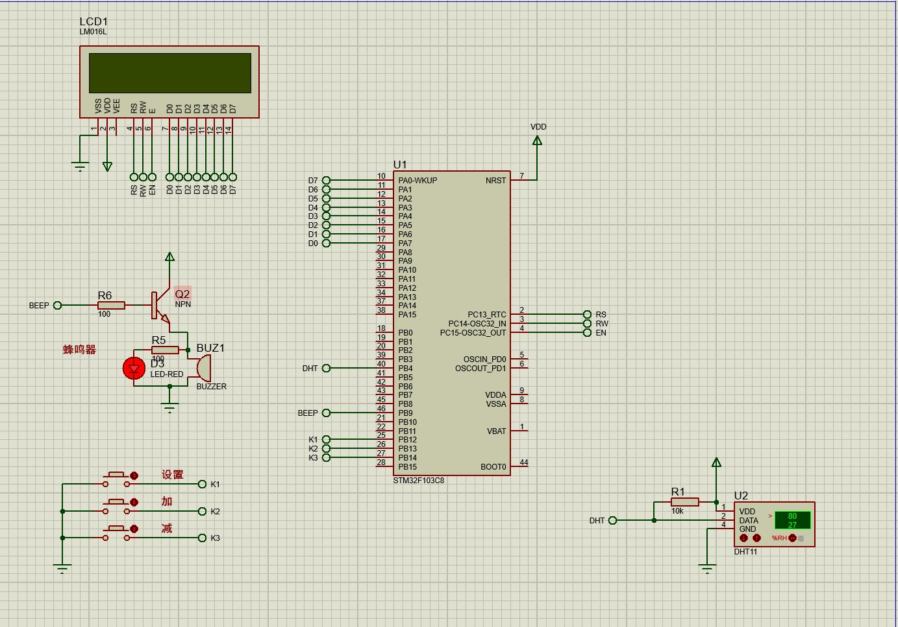
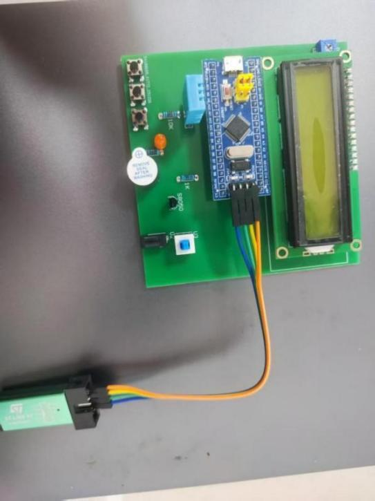

## **基于STM32的农业大棚检测系统的设计与实现**

电子信息与光电技术学院 | 通信工程

**答辩人：** 陈李柱

**指导老师：** 文乙茹 讲师

## **目 录**

**CONTENTS**

**01**

**绪论背景**

**02**

**系统总体方案设计**

**03**

**系统硬件与软件设计**

**04**

**系统测试与验证**

**05**

**论文展望**

Part.01

## **绪论背景**

**绪论背景**

**总体方案设计**

**硬件软件设计**

**测试与验证**

**总结展望**

**研究背景**

## **农业大棚智能监测系统 研究背景和目的**

### **01**

### **传统大棚痛点**

人工巡检效率低、精度差，无法实现24小时不间断监控，严重依赖人力，难以满足现代化农业生产的精细化管理需求。

### **02**

### **现有设备问题**

市面上的智能监测系统普遍成本高昂，且操作流程复杂，对于广大中小型农户而言，经济负担重，技术门槛高，难以大规模普及和应用。

### **03**

### **本设计目的**

旨在开发一款低成本、易操作、支持用户自定义报警阈值的本地监测系统，切实降低使用门槛，解决中小农户的实际需求。

**绪论背景**

**总体方案设计**

**硬件软件设计**

**测试与验证**

**总结展望**

**研究意义**

**A.**

**B.**

**C.**

**D.**

**理论意义**

探索并验证单总线通信技术在农业环境监测领域的应用效果和可靠性，为嵌入式系统设计提供实践案例。

**实践意义**

为中小型农业大棚提供一种经济实惠、易于部署的本地温湿度监测与报警方案，提升管理效率。

**推广意义**

采用模块化设计，便于维护、升级和二次开发，可作为高校相关课程的教学案例。

**教学意义**

通过复现这个项目，可以把单总线通信协议、LCD显示驱动、Flash存储读写这些核心知识点串起来，真正把课堂上学到的理论知识转换成具体的工程实践能力。

**绪论背景**

**总体方案设计**

**硬件软件设计**

**测试与验证**

**总结展望**

**研究现状与不足**

国内外现状分析

**国外研究现状**

**国内主流方案**

**存在不足与痛点**

**功能全面：** 集成多种传感器，支持数据采集、传输与远程监控，技术相对成熟。

**主要问题：** 整套设备与配套服务价格昂贵，不适合中国国情下的中小农户进行大规模推广与应用。

**主流架构：** 多采用“环境传感器 + 单片机(MCU) + 本地显示屏”的一体化设计方案。

**方案特点：** 结构简单，部署成本相对较低，可满足基础的现场查看需求。

**核心痛点：** 功能较为单一，用户通常无法自主灵活设置告警阈值；系统长期运行稳定性待提升；且普遍缺少云端数据存储与历史回溯功能。

Part.02

## **系统总体方案设计**

**绪论背景**

**总体方案设计**

**硬件软件设计**

**测试与验证**

**总结展望**

**系统功能需求**

**实时采集与显示**

利用高精度DHT11温湿度传感器实时采集环境数据，并将采集到的温湿度信息在LCD1602显示屏上实时刷新显示，便于直观监控。

**阈值设置与保存**

支持用户通过物理按键自定义温湿度的上下限报警阈值，且配置数据可保存至Flash存储芯片中，实现系统掉电后参数不丢失。

**越限声光报警**

当温湿度超出阈值范围时，系统能立即触发蜂鸣器报警，以声光形式提醒管理人员及时处理异常情况。

**稳定可靠运行**

采用硬件模块化设计降低维护难度，软件层面通过主程序轮询结构与异常处理机制，确保系统长期稳定、无故障运行。

**绪论背景**

**总体方案设计**

**硬件软件设计**

**测试与验证**

**总结展望**

**总体架构**

**主控模块**

核心器件：STM32F103C8T6

负责系统核心数据处理、逻辑运算及各外设模块的统一调度与协调。

**输入模块**

硬件组成：DHT11 + 3个独立按键

• DHT11：采集环境温湿度数据。 • 独立按键：实现系统参数设置与功能控制输入。

**输出模块**

硬件组成：LCD1602 + 有源蜂鸣器

• LCD1602：实时显示温湿度数值与系统状态。 • 蜂鸣器：在异常状态下（如温湿度超标）提供声音报警。

**驱动与电源模块**

硬件支持：S8050三极管 + 5V直流电源

• S8050：作为开关管驱动蜂鸣器，放大电流。 • 电源：为整个系统提供稳定的5V直流供电。

**系统总体框图**

单片机

数据处理

液晶显示当前信息

DHT11温湿度采集

按键设置报警上限

控制蜂鸣器进行报警

电源

LED指示灯

**Part.03**

## **系统硬件与软件设计**

**硬件电路设计**

**研究背景**

**总体方案设计**

**硬件软件设计**

**硬件软件设计**

**测试与验证**

**总结展望**

**系统硬件框图**

**主控与采集模块**

•**单片机最小系统：** 构建稳定的核心控制环境，保障芯片可靠运行。 •**温湿度采集：** 选用DHT11传感器，连接至PA0口并配置5kΩ上拉电阻，实现环境参数精准采集。

**显示与交互模块**

•**显示电路：** LCD1602 模块采用8位并行接口方式与PB口相连，高效输出温湿度数据。 •**按键模块：** 配置三个独立按键接入PA口，通过软件算法实现消抖处理，提升操作响应稳定性。

**报警驱动模块**

•**声光报警：** 利用PA4引脚输出控制信号，通过S8050三极管放大电流驱动蜂鸣器，在温湿度异常时及时发出报警提示。

**PCB 工程设计**

• 使用**Altium Designer**完成原理图与PCB版图绘制，采用模块化布局与大面积覆铜工艺，有效增强系统抗干扰能力。

### **绪论背景**

### **总体方案设计**

### **硬件软件设计**

### **关键技术难点**

### **测试与验证**

### **总结展望**

## **软件设计流程**

**上电初始化**

初始化系统时钟、GPIO、LCD、按键扫描等。

**显示刷新**

将采集到的数据格式化后显示在LCD1602上。

01

02

03

04

**越限判断与报警**

比较当前数据与阈值，超限则触发报警。

05

**数据采集**

调用DHT11驱动函数，读取温湿度数据。

**按键扫描**

检测按键输入，若有则进入阈值设置逻辑。

**主程序图**

开始

Lcd1602初始化

DHT11温湿度初始化

LCD1602显示当前信息

否

是否按下按键

是

按键设置

否

否

超过上限

超过下限

是

是

蜂鸣器报警

返回

Part.04

## **系统测试与验证**

**绪论背景**

**总体方案设计**

**实物与仿真测试**

**双重验证方法 (实物 + 仿真)**

**• 实物测试：** 基于实际焊接PCB板，还原真实环境，验证系统实际运行状况。

**• 软件仿真：** 利用Proteus搭建虚拟电路，低成本、高效率地快速验证软件逻辑。

**软硬件测试平台搭建**

**• 硬件平台：** 系统PCB板、STM32核心板、各类传感器模组、LCD显示屏等。

**• 软件平台：** Keil uVision5 (代码编写与程序烧录)、Proteus 8 (电路与逻辑仿真)。

**核心测试清单**

1.初始化 | 2.采集显示 | 3.按键功能 4.报警功能 | 5.系统稳定性 | 6.精度分析

**硬件软件设计**

**测试与验证**

**总结展望**

**Proteus 仿真电路示意图**

**实物电路示意图**

**绪论背景**

### **实物与仿真测试**

**总体方案设计**

**硬件软件设计**

**测试与验证**

**总结展望**

## **系统各模块功能测试**

**初始化测试**

**PASSED**

系统上电后，各硬件模块均正确加载并初始化，运行稳定。

**显示测试**

**PASSED**

LCD屏幕响应迅速，能实时、清晰、准确地显示各类数据。

**按键测试**

**PASSED**

物理按键灵敏度高，阈值设置、保存与切换功能均正常。

**报警测试**

**PASSED**

越限自动触发蜂鸣器报警，参数恢复正常后，报警即时解除。

**综合测试**

**PASSED**

各软硬件模块协同工作，运行流畅，完整实现了所有核心功能。

**绪论背景**

**总体方案设计**

**硬件软件设计**

**测试与验证**

**测试与验证**

**总结展望**

**实验测量与数据分析**

**实验条件与基准值**

•**实验环境：** 室内恒温恒湿的稳定环境，排除气流干扰。

•**基准设备：** 采用工业级高精度温湿度计，设定基准值：温度17.5 ℃ / 湿度48.2% RH。

**关键指标统计分析**

•**均值：** 17.51℃ / 48.35 % RH (与基准高度一致)

•**极值表现：** 最大偏差仅 ±0.2℃ / ±0.5 RH；波动范围 0.01 ℃℃ / 0.15 % RH。

**实验结论与评价**

1. 系统测量结果稳定，平均偏差极小，具有良好的准确性。

2. 实测最大偏差远优于 官方标称精度 (±2℃, ±5% RH)，满足农业大棚高标准监测要求，达成设计目标。

。

<table>
  <tr>
    <th>次数</th>
    <th>温度(℃)</th>
    <th>湿度(%)</th>
    <th>温偏差(℃)</th>
    <th>湿偏差(%)</th>
  </tr>
  <tr>
    <td>1</td>
    <td>17.5</td>
    <td>48.7</td>
    <td>0.0</td>
    <td>+0.5</td>
  </tr>
  <tr>
    <td>2</td>
    <td>17.6</td>
    <td>48.1</td>
    <td>+0.1</td>
    <td>-0.1</td>
  </tr>
  <tr>
    <td>3</td>
    <td>17.3</td>
    <td>48.3</td>
    <td>-0.2</td>
    <td>+0.1</td>
  </tr>
  <tr>
    <td>4</td>
    <td>17.4</td>
    <td>48.4</td>
    <td>-0.1</td>
    <td>+0.2</td>
  </tr>
  <tr>
    <td>5</td>
    <td>17.4</td>
    <td>48.5</td>
    <td>-0.1</td>
    <td>+0.3</td>
  </tr>
  <tr>
    <td>6</td>
    <td>17.7</td>
    <td>48.3</td>
    <td>+0.2</td>
    <td>+0.1</td>
  </tr>
  <tr>
    <td>7</td>
    <td>17.7</td>
    <td>48.5</td>
    <td>+0.2</td>
    <td>+0.3</td>
  </tr>
  <tr>
    <td>8</td>
    <td>17.4</td>
    <td>48.1</td>
    <td>-0.1</td>
    <td>-0.1</td>
  </tr>
  <tr>
    <td>9</td>
    <td>17.5</td>
    <td>48.4</td>
    <td>0.0</td>
    <td>+0.2</td>
  </tr>
  <tr>
    <td>10</td>
    <td>17.6</td>
    <td>48.2</td>
    <td>+0.1</td>
    <td>0.0</td>
  </tr>
  <tr>
    <td>统计</td>
    <td>17.51</td>
    <td>48.35</td>
    <td>+0.01</td>
    <td>+0.15</td>
  </tr>
</table>

Part.05

## **论文总结**

**课题基本结论**

**绪论背景**

**总体方案设计**

**硬件软件设计**

**测试与验证**

**总结展望**

**论文总结**

**论文结论：** 本设计成功实现了一个基于STM32的农业大棚温湿度监测系统，完整地实现了数据采集、实时显示、阈值设置、掉电保存和越限报警等核心功能。

**01**

**系统功能实现：** 系统已完成所有预定功能开发。其中，数据采集单元能稳定获取环境温湿度数据；显示单元支持实时数据刷新；用户可灵活配置报警阈值，且配置参数支持断电永久保存；当监测值超出设定范围时，系统能立即触发声光报警机制。

**02**

**达成设计目标：** 经过实物测试与数据分析，系统整体运行稳定可靠，温湿度测量精度优于预期指标。方案采用高性价比的硬件选型和高效的软件设计，成功实现了低成本、易操作、高性价比的设计初衷，具有良好的农业推广应用潜力。

**亮点与不足**

**绪论背景**

**总体方案设计**

**硬件软件设计**

**测试与验证**

**总结展望**

**亮点之处**

**1. 实用的掉电存储功能：** 利用STM32内置Flash实现报警阈值永久保存，掉电不丢失。

**2. 实测精度高：** 软硬件协同优化，系统实际温湿度测量精度优于传感器标称值。

**3. 高性价比：** 选用成熟、通用的电子元器件，在保证性能的同时有效控制成本。

**不足之处**

**1. 仅限本地监控：** 缺少物联网远程访问功能，无法随时随地查看系统状态。

**2. 缺少历史数据回溯：** 系统未配备大容量存储模块，无法记录和分析历史环境数据。

**绪论背景**

**总体方案设计**

**硬件软件设计**

**测试与验证**

**总结展望**

**未来发展方向**

**功能升级**

替换为更高精度的传感器，并引入FreeRTOS实时操作系统，增强系统并发能力。

**01**

**联网扩展**

集成Wi-Fi或NB-IoT模块，实现数据的远程传输，并对接云平台。

**02**

**03**

**手机APP交互**

开发配套的手机应用，方便用户通过手机随时随地查看数据、接收报警和远程设置。

## **致 谢**

感谢指导老师文乙茹讲师在方案设计、系统调试和论文撰写过程中给予的悉心指导和宝贵建议。

感谢电子信息与光电技术学院提供的实验平台和良好的学习环境。

感谢同学们在项目开发过程中的热心帮助和有益讨论。

## **请各位老师指正**

**答辩人**：陈李柱

**指导老师**：文乙茹 讲师